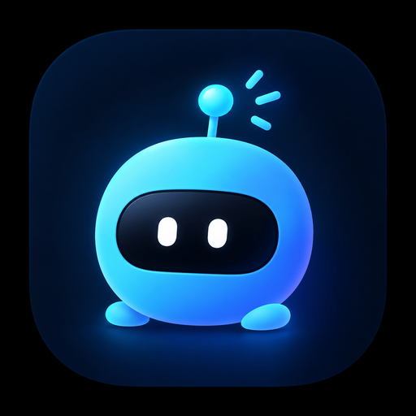

<p align="center">
  
</p>

<h1 align="center">DSH Notch Pet</h1>

<p align="center">
  <strong>Your DSH agent, living in the MacBook notch.</strong><br>
  A native companion that shows the current session, the exact step the agent is on,
  and how far the turn has come — without opening a window.
</p>

<p align="center">
  <a href="#requirements"></a>
  
  
</p>
DSH Notch Pet tucks a tiny robot into the hardware notch. At a glance it shows
the session title and the live step line that DSH shows in the chat. Hover and it
unfolds into a compact status card with elapsed turn time, task or goal progress,
the active-agent count, the model, and one-click access back to DSH.

**Jump to:** [Screenshots](#what-it-looks-like) · [Highlights](#highlights) ·
[Install](#install) · [Controls](#controls) · [Settings](#settings) ·
[Architecture](#architecture) · [Troubleshooting](#troubleshooting) ·
[License](#license)

## What it looks like


*Collapsed: the title and live step sit beside the notch, with a progress hairline
underneath. It never adds height to the strip.*


*Expanded: up to two title lines, live step, elapsed time, `Tasks 3/7`, active
agents, the goal, the model, and the controls.*

## Highlights

- **Live, not decorative.** The line under the title mirrors the step DSH shows
  below the assistant message: a changing reasoning preview while the model
  thinks, `Editing file · native/Sources/PetView.swift` while a tool runs, and
  elapsed turn time on the right. It deliberately avoids the finished assistant
  reply.
- **Progress without invented percentages.** It uses `todo_write` completion when
  DSH has tasks, and falls back to goal rounds when it does not. With no
  countable unit, the bar shimmers indeterminately while the agent works, then
  freezes or disappears when it stops.
- **Gets out of the way.** Turn on **Only while working** and the panel is ordered
  out entirely whenever no task is running. A pawprint takes its place in the menu
  bar. Pinning overrides it.
- **Six accents, honest status colors.** Glacier (the default cyan), Aurora,
  Iris, Sakura, Tangerine, and Mint, plus a custom
  hue/saturation/brightness picker. Waiting stays amber, errors stay red, and
  completed turns stay mint.
- **At home on macOS.** A nonactivating AppKit/SwiftUI panel with no Dock icon,
  no focus stealing, Reduce Motion support, and a 60 fps progress animation.
- **Speaks your language.** The panel follows your macOS language and switches
  between English and Chinese.
- **Local by design.** The host talks to the panel over a private Unix socket.
  No telemetry, no network calls, no account.

## Requirements

- macOS 14 Sonoma or newer.
- DSH Desktop, or a DSH host running inside a macOS GUI session.
- Apple Silicon or Intel — the bundled helper is a universal binary.
- Xcode Command Line Tools only if you rebuild the helper from source.

A notched MacBook is not required: on other Macs the panel floats at the top
center of the main display with rounded top corners.

## Install

Install it from inside DSH — no clone, no terminal, no Xcode.

1. Open **Plugins** in DSH and click **Add plugin**
2. Paste this address into the dialog:

   ```
   https://github.com/hyzmm/dsh-notch-pet
   ```

3. Confirm. DSH fetches the bundle and installs it for you.

Prefer the terminal? The same bundle installs from a public repository with:

```sh
dsh plugin --profile web add github:hyzmm/dsh-notch-pet
```

`web` is the DSH Desktop profile; keep the profile you actually run.

The pet appears at the top of the display a moment later. If it does not, make
sure the plugin is enabled in **Plugins**, disable and re-enable it, or restart
DSH.

The package ships a prebuilt ad-hoc-signed universal helper, so nothing is
compiled on install. DSH launches the helper itself; there is no app to open.
When the plugin is disabled or DSH quits, the helper stops with it.

### Build from source (optional, for development)

Only needed when you change the Swift sources or `native/Info.plist`:

```sh
git clone https://github.com/hyzmm/dsh-notch-pet.git
cd dsh-notch-pet
chmod +x native/build.sh
./native/build.sh
```

The script rebuilds `native/DSHNotchPet.app` as a universal binary. After that,
install the checkout the same way: **Add plugin** → the absolute path of the
folder.

## Controls

| Input | Result |
| --- | --- |
| Hover the panel | Expands, and stays open while the pointer is inside. |
| Click the robot | Pins or unpins the panel. A pinned panel ignores hover-out and **Only while working**. |
| Gear in the footer | Opens settings. |
| Pin / Open DSH in the footer | Pin the panel, or focus DSH (falling back to the web origin). |
| Right-click the panel | Open DSH, pin or unpin, open settings, or quit. |
| Launch | Peeks open for about three seconds, then settles back to the collapsed strip. |

## Settings

Open the popover with the gear, **Settings…** in the right-click menu, or the
pawprint menu bar item.

### Only while working

Turn this on to order the panel out entirely whenever no DSH task is running. The
notch and the strip below it stay free, and the panel comes back as soon as a
task starts. Waiting for your answer counts as running; idle, finished, and
failed sessions do not.

While the panel is hidden, a pawprint appears in the menu bar with **Settings…**,
**Open DSH**, the **Only while working** switch, and **Quit**. If the menu bar is
too crowded to show it, start any DSH task to bring the panel back, then reach
settings from the gear.

The preference is stored as `hideWhenIdle` in the app's `UserDefaults` and is off
by default. Pinning the panel overrides it and keeps the panel visible.

### Accent color

The popover offers six presets — Glacier (the default cyan-to-blue), Aurora,
Iris, Sakura, Tangerine, and Mint — plus a custom picker with hue, saturation,
and brightness controls. Each swatch shows both stops of the pet's body
gradient.

| Preset | Accent | Gradient end |
| --- | --- | --- |
| Glacier (default) | `#45D1FA` | `#5B7CFF` |
| Aurora | `#5B7CFF` | `#3D5BFF` |
| Iris | `#A78BFA` | `#7C5CFF` |
| Sakura | `#FF8FB8` | `#FF5C9E` |
| Tangerine | `#FFA65C` | `#FF7A3D` |
| Mint | `#46E0A6` | `#21B98A` |

The accent recolors the working pet, the resting pet, the glow behind it, the
loading arc, the progress bar, and the status dot. Glacier uses the same cyan
whether a task is running or not, so the resting panel keeps the artwork tone
instead of turning slate. The pet's body blends the accent into its companion
tone, so Glacier keeps the original cyan body with a blue underside. The
semantic states stay readable with any accent: waiting is amber, errors are
red, and a completed turn is mint. Changes apply live, survive relaunches, and
are stored in `accentHex` in the app's `UserDefaults`. **Reset** returns to
Glacier. Upgrading from an earlier build migrates the old default blue and the
previous Glacier cyan to Glacier; the blue remains available as Aurora.

## What the pet shows

### Which session?

The panel focuses one session: a running root session when there is one,
preferring the most recently active. If only subagents are running, the most
recent subagent takes the spotlight. Running subagents count toward the
active-agent total.

The title is DSH's own session title, so an auto-generated or user-renamed title
wins. The first prompt is a fallback, then the workspace folder name.

### The live line

The narrow line mirrors the live step, not the final answer. While the model is
thinking it is `Thinking · <latest reasoning>`, built from reasoning deltas and
trimmed to a sentence-aligned preview that keeps changing. While a tool runs it
is `Editing file · native/Sources/PetView.swift`, `Running command · Build the
native app`, and so on. The elapsed time on the right is the current turn's
duration.

The collapsed strip has room for two compact lines under the hardware notch, so
it shows the session title plus the live step. The new information uses the empty
width beside the notch instead of adding height.

### Progress

With a `todo_write` list, the bar tracks `Tasks 3/7`. Without tasks but with a
goal that has rounds, it tracks `Goal 2/6 rounds`. Without either, it becomes an
indeterminate band while the agent is busy. When the agent is idle, the
indeterminate band is hidden and any determinate bar is frozen, so the notch does
not keep flashing.

The expanded panel also shows the goal objective, the last error, or a short
status hint in the footer. The step text itself does not move; the loading arc
and the progress shimmer animate while the agent works.

### Motion

Active progress runs at 60 fps, the robot bobs and blinks, and the loading arc
leads the step line. Expanding or collapsing uses an animated notch transition.
Reduce Motion turns off the movement while keeping the state readable.

## Privacy

Everything stays on your Mac. The host writes the current state to a per-process
Unix socket (`0600`) under `~/Library/Application Support/DSHNotchPet/`, and the
panel reads it. The plugin makes no network calls, collects no telemetry, and
needs no account.

## Limits

- macOS only; the host half is a no-op on other platforms.
- One focus session at a time. Subagents contribute to the active count, but the
  panel does not show a session list.
- The panel lives on the first notched display. It does not follow the DSH window
  to another screen.
- Live state only: no history, no transcript, and no controls for the agent. The
  pet is a viewer, not a controller.

## License

MIT © 2026 WengXiang. See [LICENSE](LICENSE).

<p align="center"><sub>Built with AppKit, SwiftUI, and a Unix socket.</sub></p>
