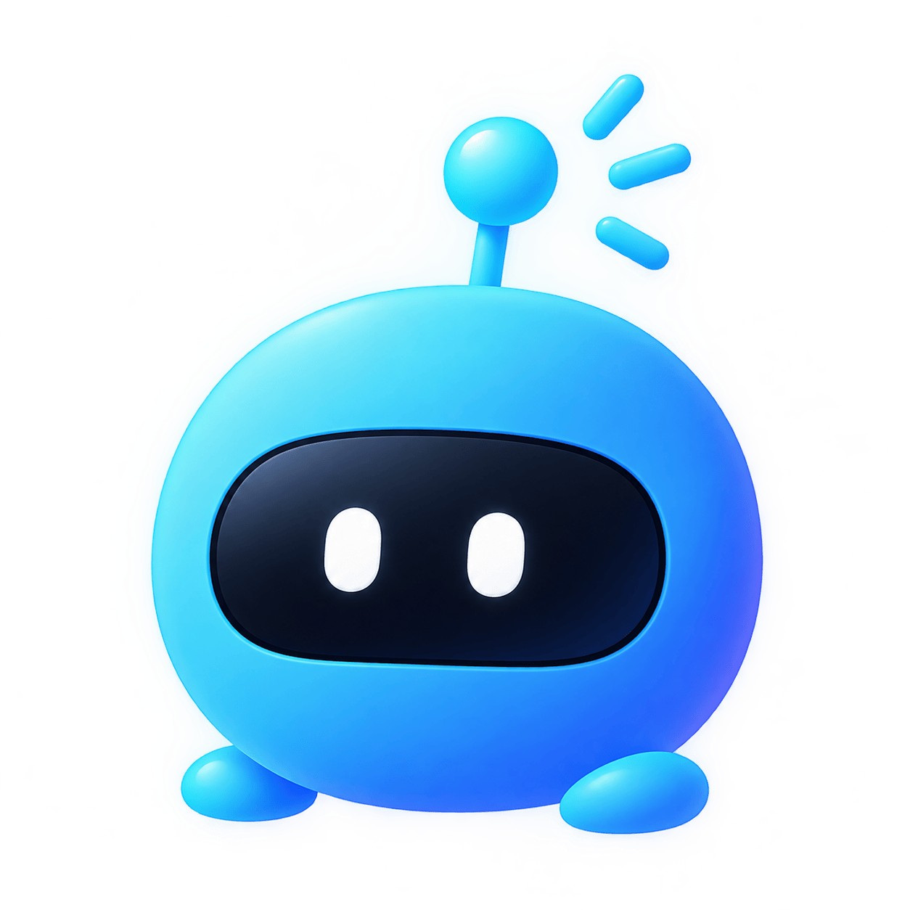
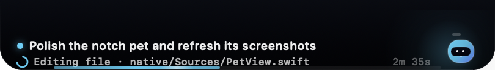
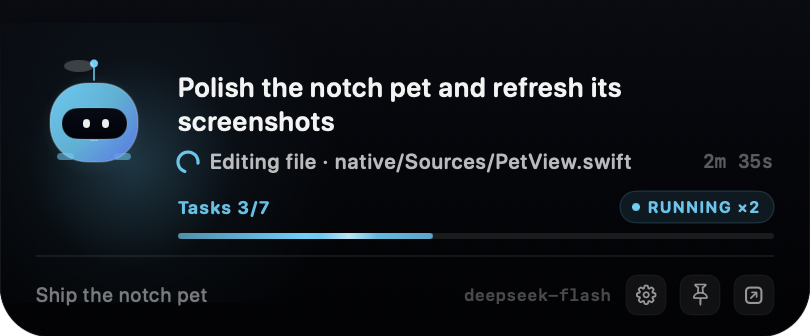

<p align="center">
  
</p>

<h1 align="center">DSH Notch Pet</h1>

<p align="center">
  <strong>Your DSH agent, living at the top of the screen.</strong><br>
  On macOS it tucks into the MacBook notch. On Windows it floats at the top
  center of the primary display. Either way it shows the current session, the
  exact step the agent is on, and how far the turn has come — without opening a
  window.
</p>

<p align="center">
  <a href="#requirements"></a>
  <a href="#requirements"></a>
  
</p>

DSH Notch Pet shows the session title and the live step line that DSH shows in
the chat. Hover and it unfolds into a compact status card with elapsed turn
time, task or goal progress, the session's token usage, the active-agent count,
the model, and one-click access back to DSH.

**Jump to:** [Screenshots](#what-it-looks-like) · [Highlights](#highlights) ·
[Install](#install) · [Controls](#controls) · [Settings](#settings) ·
[Architecture](#architecture) · [Troubleshooting](#troubleshooting) ·
[License](#license)

## What it looks like



*macOS, collapsed: the title and live step sit beside the notch, with a progress
hairline underneath. It never adds height to the strip.*



*macOS, expanded: up to two title lines, live step, elapsed time, `Tasks 3/7`,
active agents, the session's token usage and cache hit, the goal, the model, and
the controls.*

## Highlights

- **Live, not decorative.** The line under the title mirrors the step DSH shows
  below the assistant message: a changing reasoning preview while the model
  thinks, `Editing file · native/Sources/PetView.swift` while a tool runs, and
  elapsed turn time on the right. It deliberately avoids the finished assistant
  reply.
- **Progress without invented percentages.** It uses `todo_write` completion when
  DSH has tasks, and falls back to goal rounds when it does not. With no
  countable unit, the bar shimmers indeterminately while the agent works, then
  freezes or disappears when it stops.
- **The session's bill, not a guess.** The expanded footer reads the same
  provider-reported `tokenUsage` projection as DSH's own Usage pill: cumulative
  billed input plus output, with the cache-hit share beside it. No estimator and
  no extra model calls.
- **Gets out of the way.** Turn on **Only while working** and the panel is ordered
  out entirely whenever no task is running. A pawprint takes its place in the
  menu bar or system tray; on macOS a second switch hides that too. Pinning
  overrides it. Prefer a quieter top edge? **Hide pet** drops the animated mascot
  and its glow while keeping the session title, live step, progress, and token
  readout.
- **Six accents, honest status colors.** Glacier (the default cyan), Aurora,
  Iris, Sakura, Tangerine, and Mint, plus a custom hue/saturation/brightness
  picker. Waiting stays amber, errors stay red, and completed turns stay mint.
- **At home on both platforms.** macOS uses a nonactivating AppKit/SwiftUI panel
  with no Dock icon; Windows uses a nonactivating WPF window with no taskbar
  button, per-monitor DPI scaling, Reduce Motion support, and the same 60 fps
  progress animation. Neither steals focus.
- **Bilingual without a restart.** The interface follows the macOS or Windows
  display language by default and falls back to English for every other locale.
  **Settings → Language** switches between Follow system, English, and 中文, and
  the panel, menu, and settings update immediately.
- **Local by design.** The host talks to the panel over a private Unix socket on
  macOS and a per-user named pipe on Windows. No telemetry, no network calls, no
  account.

## Requirements

- **macOS 14 Sonoma or newer**, or **Windows 10 (1809 or newer) / Windows 11**
  with .NET Framework 4.8. Current Windows 10 and Windows 11 releases include
  4.8; Windows Update can install it if a machine is missing it.
- DSH Desktop, or a DSH host running inside a macOS or Windows GUI session.
- The bundled helpers are prebuilt: an ad-hoc-signed universal binary for macOS
  and a .NET Framework executable for Windows. Nothing is compiled on install.
- Xcode Command Line Tools only if you rebuild the macOS helper; PowerShell and
  the in-box .NET Framework compiler only if you rebuild the Windows helper.

A notched MacBook is not required: on other Macs the panel floats at the top
center of the main display with rounded top corners. Windows PCs have no
hardware notch, so they always use that rounded-top presentation.

## Install

1. Open **Plugins** in DSH and click **Add plugin**
2. Paste this plugin name `dsh-notch-pet` into the dialog:
3. Confirm. DSH fetches the bundle and installs it for you.

Prefer the terminal? The same bundle installs from a public repository with:

```sh
dsh plugin --profile web add github:hyzmm/dsh-notch-pet
```

`web` is the DSH Desktop profile; keep the profile you actually run.

The pet appears at the top of the display a moment later. If it does not, make
sure the plugin is enabled in **Plugins**, disable and re-enable it, or restart
DSH.

The Windows helper is an unsigned, locally built `.exe`. DSH launches it
directly, so no installer or background service is involved. When the plugin is
disabled or DSH quits, the helper stops with it.

## Controls

| Input | Result |
| --- | --- |
| Hover the panel | Expands, and stays open while the pointer is inside. |
| Click the robot | Pins or unpins the panel. A pinned panel ignores hover-out and **Only while working**. |
| Gear in the footer | Opens settings. |
| Pin / Open DSH in the footer | Pin the panel, or return to DSH — the desktop app, falling back to the web origin. |
| Right-click the panel | Open DSH, pin or unpin, open settings, or quit. |
| Pawprint in the menu bar / system tray | Appears while the panel is hidden: Settings, Open DSH, the **Only while working** and **Hide pet** switches, and Quit. |
| Launch | Peeks open for about three seconds, then settles back to the collapsed strip. |
| Click an accent, toggle, or drag the picker | Applies immediately and is remembered for the next launch. |

## What the pet shows

### Which session?

The panel focuses one session: a running root session when there is one,
preferring the most recently active. If only subagents are running, the most
recent subagent takes the spotlight. Running subagents count toward the
active-agent total.

The title is DSH's own session title, so an auto-generated or user-renamed title
wins. The first prompt is a fallback, then the workspace folder name.

### The live line

The narrow line mirrors the live step, not the final answer. While the model is
thinking it is `Thinking · <latest reasoning>`, built from reasoning deltas and
trimmed to a sentence-aligned preview that keeps changing. While a tool runs it
is `Editing file · native/Sources/PetView.swift`, `Running command · Build the
native app`, and so on. The elapsed time on the right is the current turn's
duration.

The collapsed strip has room for two compact lines under the top edge, so it
shows the session title plus the live step. The new information uses the empty
width beside the panel instead of adding height.

### Progress

With a `todo_write` list, the bar tracks `Tasks 3/7`. Without tasks but with a
goal that has rounds, it tracks `Goal 2/6 rounds`. Without either, it becomes an
indeterminate band while the agent is busy. When the agent is idle, the
indeterminate band is hidden and any determinate bar is frozen, so the panel
does not keep flashing.

### Token usage

The expanded footer shows the focused session's cumulative provider-reported
tokens — the same `tokenUsage` projection behind DSH's own Usage pill — as
`21.9K tok · 94% hit`. The total is billed input (uncached, cache read, and cache
write) plus output; `hit` is the cache-read share of prompt-side input, and a
partial hit never rounds up to 100%. Hover the readout for the exact breakdown.
If `dsh-token-meter` is not mounted, the host falls back to folding each
`assistant/message` usage record.

The expanded panel also shows the goal objective, the last error, or a short
status hint in the footer. The step text itself does not move; the loading arc
and the progress shimmer animate while the agent works.

## Settings

The gear opens the same settings popover on both platforms:

- **Accent color** — six presets and a custom HSB field. The choice is stored
  under the user's profile and restored on the next launch.
- **Language** — **Follow system** (the default), **English**, or **中文**. With
  Follow system selected, Chinese Windows/macOS displays Chinese and any other
  system language displays English. The choice is saved and applied immediately;
  no helper restart is needed.
- **Only while working** — hide the panel when no task is running. The pawprint
  appears in the menu bar or system tray instead.
- **Hide pet** — keep the task details but hide the animated mascot and its glow.
- **Hide menu bar icon (macOS)** — suppress the pawprint too. Starting any task
  still brings the panel back, so it is never permanently lost. Windows always
  keeps the notification-area pawprint while the panel is hidden.

On Windows the pawprint is a notification-area icon; on macOS it is a menu-bar
status item. Both open the same menu.

## Architecture

```
DSH host (Cordis plugin, index.js)
  │  normalizes agent/status, tool/call, todo_write, usage, turn and goal events
  │
  ├── macOS:  private Unix socket (~/Library/Application Support/DSHNotchPet)
  │           └── native/DSHNotchPet.app  (Swift · AppKit · SwiftUI)
  │
  └── Windows: per-user named pipe (\\.\pipe\dsh-notch-pet-<pid>)
              └── native/windows/bin/DSHNotchPet.exe  (C# · WPF)
                  and a user-local snapshot fallback in
                  %LOCALAPPDATA%\DSHNotchPet\state-<pid>.json
```

The host half is shared and platform-neutral above the transport layer. It
builds a single snapshot from DSH's own services and events, so the two helpers
render the same data model. The Windows helper is a native WPF overlay compiled
against .NET Framework 4.8; it does not require Electron, a browser, or a
developer SDK at install time. It is nonactivating, has no taskbar button, sits
above normal windows, and uses per-monitor DPI scaling.

### Rebuilding the Windows helper

From a normal PowerShell on Windows:

```powershell
powershell -ExecutionPolicy Bypass -File native/windows/build.ps1
```

The script uses the in-box .NET Framework `csc.exe` and writes
`native/windows/bin/DSHNotchPet.exe`. It needs no Visual Studio installation.
The source is under `native/windows/src`.

## Privacy

Everything stays on your computer. On macOS the host writes the current state to
a per-process Unix socket (`0600`) under
`~/Library/Application Support/DSHNotchPet/`, and the panel reads it. On Windows
the state goes to a per-user named pipe and, when no pipe client is attached, to
a user-local snapshot under `%LOCALAPPDATA%\DSHNotchPet\`. The plugin makes no network
calls, collects no telemetry, and needs no account. The Windows fallback exists
for managed environments that deny named-pipe clients; it never leaves the
user's profile.

Logs are local too:

- macOS: `~/Library/Logs/DSHNotchPet.log` and `DSHNotchPet-host.log`
- Windows: `%LOCALAPPDATA%\DSHNotchPet\logs\DSHNotchPet.log` and
  `DSHNotchPet-host.log`

## Troubleshooting

- **Nothing appears.** Make sure the plugin is enabled in **Plugins**, then
  disable and re-enable it. The helper is launched by DSH; there is no app to
  open.
- **Only while working is on and no task is running.** Look for the pawprint in
  the system tray (Windows) or menu bar (macOS); it always appears on Windows.
  On macOS, if **Hide menu bar icon** is also on, start any DSH task and the
  panel will return.
- **On Windows, Open DSH opens a browser instead of the desktop app.** The
  button follows the host that serves the session. A session hosted by DSH
  Desktop raises the Desktop window instead — restoring it from the tray or from
  behind other windows — and only starts the application again when every window
  is gone. A session served by `dsh web` in a terminal has no window, so the
  browser is the right destination.
- **The Windows panel does not appear.** Check
  `%LOCALAPPDATA%\DSHNotchPet\logs\DSHNotchPet-host.log` and
  `DSHNotchPet.log`. Confirm .NET Framework 4.8 is installed. If you are
  developing the helper, rebuild it with `native/windows/build.ps1`.
- **The macOS panel does not appear.** Rebuild with `native/build.sh` if you
  changed the Swift sources; otherwise check the logs above.
- **Need to debug the transport.** Set `DSH_NOTCH_PET_DISABLE_OVERLAY=1` before
  starting DSH to skip the native overlay, then inspect `current.json` and the
  host log.

## Limits

- macOS 14+ or Windows 10/11 only; the host half is a no-op elsewhere.
- On Windows the panel lives on the primary display. It does not follow the DSH
  window to another monitor and is not mirrored to every virtual desktop.
- Windows has no hardware notch, so the panel always uses rounded top corners
  and a small top gap, the same treatment macOS uses on non-notched Macs.
- One focus session at a time. Subagents contribute to the active count, but the
  panel does not show a session list.
- Live state only: no history, no transcript, and no controls for the agent. The
  pet is a viewer, not a controller.

## License

MIT © 2026 WengXiang. See [LICENSE](LICENSE).

<p align="center"><sub>Built with AppKit, SwiftUI, WPF, a Unix socket, and a named pipe.</sub></p>
