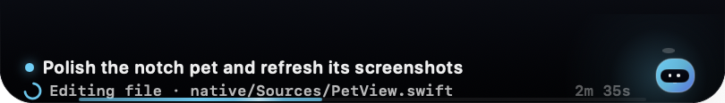
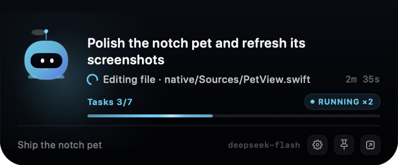

# DSH Notch Pet

A macOS notch companion for DSH. It peeks out of the hardware notch, shows the session's task title and the live step line that DSH shows below the assistant message, and expands on hover to show the title, live step, elapsed time, task progress, and goal progress.





## Architecture

- `index.js` is the Host half. It folds live `session/event`, `agent/status`, `goal/changed`, and `agent/error` events into a small per-session state, then writes newline-delimited JSON to a private Unix socket.
- `native/DSHNotchPet.app` is a menu-less AppKit/SwiftUI panel positioned at the top center of the notched display. It reads the socket, draws the pet, and animates progress.
- The Host kills the panel when the plugin unloads. The panel also exits about 20 seconds after the socket disappears, so a crashed Host does not leave an orphan overlay.

The socket lives at `~/Library/Application Support/DSHNotchPet/pet-<pid>.sock` with mode `0600`. `current.json` in the same directory names the live socket for diagnostics.

## Build the native app

```sh
chmod +x native/build.sh
./native/build.sh
```

The script builds an ad-hoc-signed universal binary at `native/DSHNotchPet.app`. Re-run it after changing Swift sources. When DSH is already running, disable and re-enable the plugin to relaunch the panel with the new binary.

Logs:

- Host lifecycle: `~/Library/Logs/DSHNotchPet-host.log`
- Native panel: `~/Library/Logs/DSHNotchPet.log`

## Progress model

The pet shows the most recently active root session. A subagent-heavy run still contributes to the active count. The title is DSH's own session title (`ctx.sessionTitle`), so an auto-generated or user-renamed title wins over the raw first prompt; the prompt is only a fallback. The collapsed notch strip has room for two compact lines under the hardware notch, so it shows that title plus the live step line the DSH chat shows below the assistant message. While the model is thinking, that line is `Thinking · <latest reasoning>`, fed by the `agent/assistant-stream` reasoning deltas and reduced to a sentence-aligned preview that keeps changing. While a tool runs, it is `Editing file · native/Sources/PetView.swift` or `Running command · Build the native app`. It deliberately does not use the finished assistant reply text. The line does not blink; the accent loading arc leads it while the agent is working. The collapsed panel keeps its original height; the new information uses the empty width beside the notch instead of adding space.

The expanded panel shows:

- session title, wrapped to two lines
- the same live step or reasoning line with elapsed turn time
- `todo_write` completion, falling back to goal rounds
- the goal objective, last error, or a short status hint

No percentage is invented when DSH has no countable unit: without one, the bar stays indeterminate while the agent is active. When the agent is idle, the indeterminate bar is hidden and any determinate bar is frozen, so the notch does not keep flashing. Active progress runs at 60 fps, and expanding or collapsing the panel uses an animated notch transition. The step text itself is static; only the loading arc animates, and it stops when the agent is idle or Reduce Motion is on.

## Controls

- Hover: expand
- Click the pet: pin or unpin the panel
- Palette button in the expanded footer: open the accent settings
- Open DSH: focuses the running DSH desktop app; falls back to the web origin only when the desktop app is not installed
- Right click: open DSH, pin, change the accent, or quit the pet

## Accent color

The expanded panel has a palette button, and the right-click menu has **Accent Color…**. The popover offers six presets — Aurora (the default blue), Glacier, Iris, Sakura, Tangerine, and Mint — plus a custom picker with hue, saturation, and brightness controls.

The accent recolors the working pet, the resting pet, the glow behind it, the loading arc, the progress bar, and the status dot. Waiting stays amber, errors stay red, and a completed turn stays mint so the status is still readable with any accent. Changes apply live, survive relaunches, and are stored in the app's `UserDefaults` (`local.dsh.notchpet`). **Reset** returns to Aurora.

## Requirements

- macOS 14 or newer
- DSH Desktop or a DSH Host running inside a macOS GUI session
- Apple Silicon or Intel (the app is universal)
